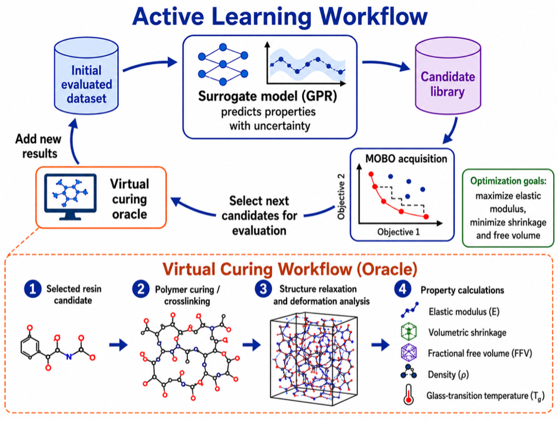

# EloKriti

Chemistry-aware active learning for the discovery of BPA-free dental resin
backbones using molecular-dynamics-derived network properties.

This repository contains the active-learning and multi-objective
Bayesian-optimization code used in:

**Active-Learning Discovery of BPA-Free Dental Resin Candidates through Backbone Screening and Network Validation**

<p align="center">
  
</p>

## Overview

EloKriti uses Gaussian-process surrogate models to prioritize unevaluated
candidate backbones for explicit virtual-curing and molecular-dynamics
evaluation.

The three optimization objectives are:

- maximize elastic modulus;
- minimize volumetric shrinkage;
- minimize fractional free volume.

The surrogate models are used only for candidate selection. Final property
values and Pareto assignments are based on explicit molecular-dynamics
evaluations.

## Repository structure

```text
EloKriti/
├── polymers_bo/
│   ├── data.py
│   ├── surrogate.py
│   ├── bo.py
│   └── suggest.py
├── scripts/
│   ├── suggest_next.py
│   ├── analyze_hypervolume.py
│   └── make_al_progress.py
├── notebooks/
│   └── candidate_pool_construction.ipynb
├── images/
│   └── AL_Workflow_Final.png
├── environment.yml
├── requirements.txt
├── README.md
└── LICENSE
```

## Requirements

The Python packages required for the active-learning, candidate-pool
construction, and analysis workflows are:

```text
numpy==1.26.4
pandas==2.3.3
scipy==1.17.0
scikit-learn==1.8.0
matplotlib==3.10.8
rdkit==2024.03.5
tqdm==4.67.3
```

Install the required Python packages using:

```bash
pip install -r requirements.txt
```

A complete Conda environment specification used for the molecular-simulation
and analysis workflow is provided in `environment.yml`.

The principal software versions used for the molecular-simulation workflow
were:

```text
Python       3.11.14
HTPolyNet    1.0.9
GROMACS      2025.4
AmberTools   24.8
GAFF         1.81
```

## Input files

EloKriti uses two primary CSV files:

1. a candidate-pool file containing candidates available for active-learning selection;
2. an evaluated-candidate file containing candidates for which MD-derived objective values are available.

The candidate-pool CSV must contain:

```text
reaction_id
reactant_1
molecular_weight_Boltzmann_average
logP_Boltzmann_average
TPSA_Boltzmann_average
normalized_monomer_phi_Boltzmann_average
normalized_backbone_phi_Boltzmann_average
```

The evaluated-candidate CSV contains the same candidate information together
with:

```text
elastic_modulus
volumetric_shrinkage
ffv
status
iteration
```

Here:

- `elastic_modulus` is the MD-derived elastic modulus;
- `volumetric_shrinkage` is the MD-derived volumetric shrinkage;
- `ffv` is the fractional free volume;
- `status` records the outcome of the candidate evaluation;
- `iteration` records the active-learning iteration associated with the evaluation.

Only successfully evaluated candidates with complete values for all three
optimization objectives are used to train the surrogate models. 

The study-specific input CSV files used by these scripts are provided in the
associated Zenodo archive. After downloading the archive, place the required
CSV files in a local `data/` directory at the repository root.

## Candidate-pool construction

The construction of the 1000-candidate EloKriti screening pool is documented
in:

```text
notebooks/candidate_pool_construction.ipynb
```

The notebook reproduces the structural filtering, canonical-structure
deduplication, and diversity-selection procedure used to construct the
candidate pool. The workflow includes polymerization-mechanism and
molecular-weight filtering, exclusion of BPA/BPF/BPS/BPAF structural motifs,
canonical-SMILES deduplication, and Morgan-fingerprint-based Butina clustering
followed by greedy MaxMin selection.

The GAFF-compatible intermediate candidate table (`gaff_ok.csv`) and the
study-specific candidate tables required to reproduce this workflow are
provided with the associated Zenodo research-data archive.

## Run candidate selection

From the repository root, run:

```bash
python scripts/suggest_next.py \
  --candidate-csv candidate_pool.csv \
  --evaluated-csv evaluated_clean_no_expansion.csv \
  --output-csv next_candidates.csv \
  --top-k 10 \
  --seed 42 \
  --scalarizations 64
```

The script ranks the unevaluated candidates and writes the selected batch to
`next_candidates.csv`.

After the selected candidates are evaluated using the molecular-dynamics
workflow, the successful results are added to the evaluated-candidate CSV and
the selection procedure can be repeated for the next acquisition round.

## Hypervolume calculations

The hypervolume and Pareto-front analyses reported in the paper were performed
retrospectively after the molecular-dynamics evaluations were completed.

To reproduce the hypervolume analysis, run:

```bash
python scripts/analyze_hypervolume.py \
  --input evaluated_clean_no_expansion.csv \
  --output-prefix al_hypervolume \
  --mc-samples 300000 \
  --seed 42
```

This script:

- transforms the objectives to a common maximize-all convention;
- computes the cumulative Pareto front at each active-learning iteration;
- normalizes the objectives using fixed bounds from the complete evaluated set;
- estimates dominated hypervolume using 300,000 Monte Carlo samples;
- uses random seed 42 and the same Monte Carlo sample set for all iterations.

To regenerate the active-learning progress figure, run:

```bash
python scripts/make_al_progress.py
```

The active-learning progress script uses
`evaluated_clean_no_expansion.csv` as the evaluated-candidate dataset.

The hypervolume analysis is used only as a retrospective progress metric and
does not contribute to candidate acquisition. 

## Validation and robustness analyses

Additional analyses performed during peer review are provided in the scripts/
directory.

The following scripts are included:

scripts/pi1070_selection_benchmark.py
scripts/representation_sensitivity.py
scripts/scalarization_batch_benchmark.py

## PI1070 candidate-selection benchmark

This analysis compares the EloKriti acquisition strategy with uniform-random
selection and greedy maximin space-filling selection on the fully evaluated
PI1070 polymer dataset.

Run with:

```bash
python scripts/pi1070_selection_benchmark.py \
  --dataset data/PI1070.csv \
  --seeds 50
```

The default evaluation budgets are:

10, 19, 27, 35, 41, 50, 57, 66, 71

The analysis reports Pareto recall and normalized hypervolume recovery.

## Representation-sensitivity analysis

This analysis evaluates the sensitivity of surrogate performance to the
molecular representation using chronological pre-acquisition validation.

Run with: 

```bash
python scripts/representation_sensitivity.py \
  --evaluated data/evaluated_clean_no_expansion.csv \
  --repeats 10
```

The tested representations include the original TF-IDF/SVD representation,
case-preserving SMILES representations, continuous molecular descriptors,
Morgan fingerprints combined with descriptors, and canonicalized SMILES
representations.

## Scalarization and batch-selection sensitivity

This analysis evaluates sensitivity to the number of random objective
scalarizations and to the batch-selection strategy using the PI1070 benchmark.

Run with:

```bash
python scripts/scalarization_batch_benchmark.py \
  --data data/PI1070.csv \
  --seeds 20
```

The analysis compares 16, 32, 64, 128, and 256 random linear scalarizations
and additionally evaluates a diversity-aware batch-selection strategy using
64 scalarizations.

The EloKriti acquisition strategy is a ParEGO-inspired
random-linear-scalarization expected-improvement procedure and is not an
implementation of standard ParEGO.

Numerical outputs used in the revised manuscript and Supporting Information
are archived in the associated Zenodo research-data record.

### Chronological surrogate validation

Out-of-sample surrogate performance was evaluated using chronological
pre-acquisition validation. For each active-learning round, the surrogate was
trained only on candidates whose MD labels were available before that round
and then evaluated on candidates acquired in that round.

Run with:


```bash
python scripts/preacquisition_surrogate_diagnostics.py \
  --evaluated data/evaluated_clean_no_expansion.csv
```
## Surrogate baseline comparison 

The original Gaussian-process surrogate was additionally compared with a
simple linear-regression baseline using the five continuous molecular
descriptors. The same chronological pre-acquisition train/test protocol is
used for both models. 

```bash
python scripts/surrogate_baseline_comparison.py \
  --evaluated data/evaluated_clean_no_expansion.csv
```

## Structure-similarity audit 

To assess possible structural overlap across the chronological training and
validation boundary, each post-initial candidate is compared only with
candidates whose labels were available before its acquisition round. 

```bash
python scripts/structure_similarity_audit.py \
  --evaluated data/evaluated_clean_no_expansion.csv
```

## Reproducibility

The repository contains the executable active-learning,
Gaussian-process-surrogate, candidate-selection, Pareto-analysis,
hypervolume-analysis, and candidate-pool-construction workflows associated
with EloKriti.

The Python dependencies are provided in `requirements.txt`, while the complete
Conda environment used for the molecular-simulation and analysis workflow is
provided in `environment.yml`.

Large study-specific molecular-dynamics files and simulation artifacts are
kept separately from the executable source code.

## Data availability

This GitHub repository contains the executable active-learning and
Bayesian-optimization code associated with EloKriti.

The accompanying research-data archive will contain the study-specific
evaluated-candidate tables, molecular structures, molecular-dynamics inputs and
outputs, simulation topologies, construction diagnostics, and processed
property data used in the revised manuscript.

These data will be deposited in a versioned Zenodo research-data record. The
Zenodo DOI and corresponding versioned GitHub release will be added here when
the research-data record is finalized.

## Citation

If you use this code, please cite:

**Active-Learning Discovery of BPA-Free Dental Resin Candidates through Backbone Screening and Network Validation**

The final journal citation and DOI will be added after publication.

## License

This project is distributed under the MIT License. See `LICENSE`.
